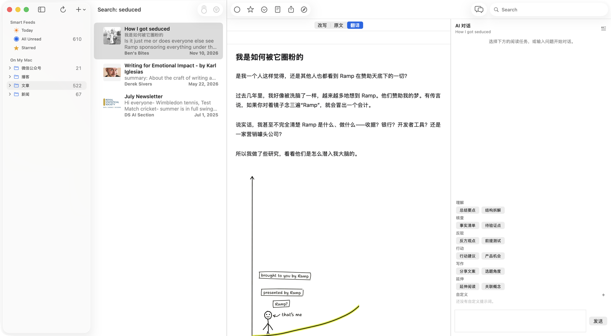
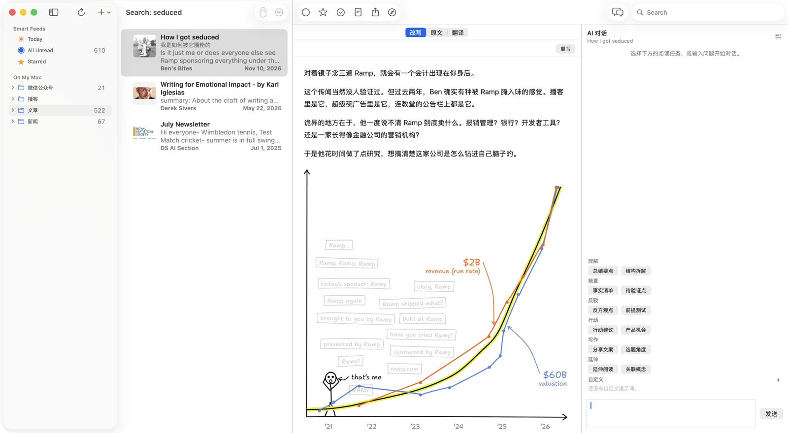
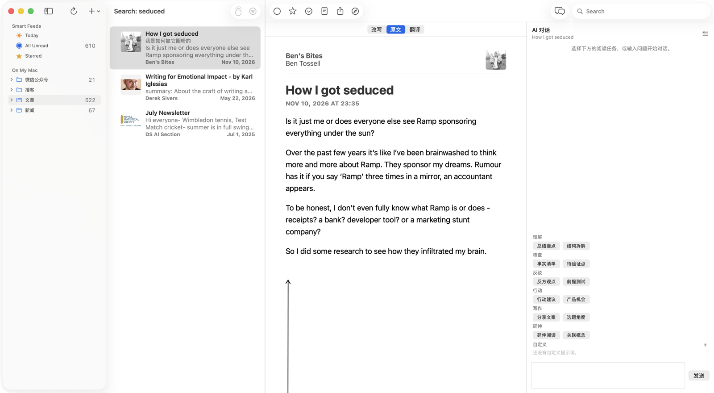
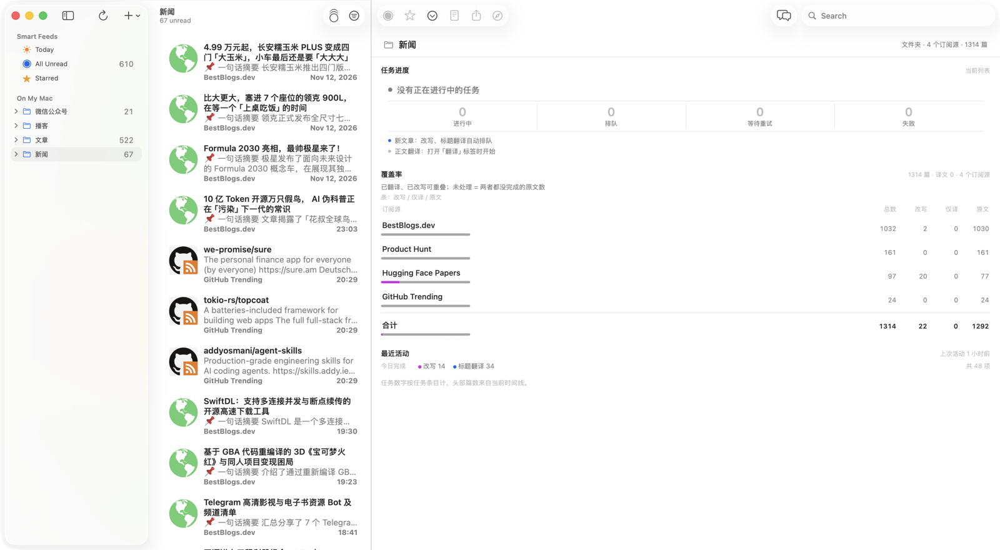

# NetNewsWire

这是 NetNewsWire 的个人 fork。上游是 macOS / iOS 上的原生 RSS 阅读器；本 fork 在 macOS 端加入 AI 加工、任务看板和内容源增强。上游项目见 [https://github.com/Ranchero-Software/NetNewsWire](https://github.com/Ranchero-Software/NetNewsWire)，官网 [https://netnewswire.com/](https://netnewswire.com/)。

AI 功能需要本机运行 magpie 网关。iOS 端保持上游行为，不包含这些 AI 功能。

## 新增功能

### AI 加工

**标题中文化**

配置网关后，新到的非中文文章会自动补一行中文译名，显示在时间线原题下方。积压的标题按批次送模型，不逐条发请求。

**正文翻译**

打开阅读区的「翻译」页签时才生成，不在后台预翻。先整篇送模型；一次翻不完时，失败后把正文分块重试。某块失败后，已完成的块会保留，下次从断点继续。译文以纯中文排版显示。

**改写**

普通文章、论文、Product Hunt 使用不同的改写提示词；Product Hunt 在普通文章提示词上追加产品改写要求。普通文章如果订阅源只给摘要，会先抓原文页提取正文；抓不到或提取不到更长的正文时，退回订阅源自带的正文。论文和 Product Hunt 不做这一步，直接使用订阅源内容。极短或没有正文的普通文章会直接跳过。普通文章提示词要求保留原文的关键数据和核心结论、不遗漏、不夸大，且不改变原意；论文提示词额外要求只基于给定材料、不编造实验和结论；Product Hunt 提示词额外要求不编造价格、团队、融资、用户量等材料里没有的信息。改写结果先过质量校验，中文过短、段落不足或模型拒答不会入库。

自动改写默认开启，范围是最近 2 天、正文 200 字以上的未读非中文文章；手动打开改写不受这个范围限制。

**AI 伴读**

右侧 AI 对话按文章保存全部历史。每次请求带上整篇正文和该文章之前的对话。内置 12 条阅读任务，按理解、核查、反驳、行动、写作、延伸分组，点一下即发送。自定义提示词最多 24 条，保存在本地。原文页选中文本后可以引用，作为引用块带进输入框。

**缓存与重试**

标题和改写按内容哈希缓存，内容变化后会重新生成；译文生成后保留，不自动重跑。失败任务按 10 分钟、30 分钟、2 小时退避，最多尝试 4 次；终态失败可以在任务看板手动重试。

### 任务看板与日志

阅读区没有选中文章时显示任务看板，统计范围跟随当前列表：订阅源、文件夹、Today、全部未读或收藏。顶部是进行中、排队、等待重试、失败四项；下面是逐订阅源的覆盖率，列为改写、仅译和原文；失败任务按原因分组，展开可以看到涉及哪些订阅源，并一次「重试全部」。网关没有配置时，看板会直接提示。

翻译、标题中文化和改写的终态会写入 `Application Support/NetNewsWire/AI/logs/ai-tasks-YYYY-MM-DD.jsonl`，即 `~/Library/Application Support/NetNewsWire/AI/logs/`，每天一个文件。写入时清理超过 30 天的日志。

### 阅读与界面

主窗口是侧栏、列表、阅读区、AI 对话栏四栏，AI 栏可以随时收起。阅读区顶部最多三个页签：「改写 / 原文 / 翻译」；每个订阅源可以单独关闭改写或翻译，文章不支持 AI 时只留原文。

沉浸阅读隐藏侧栏和列表，让正文占满剩余空间；AI 栏保持当前显示状态。按 `I` 进入或退出，按 `Esc` 也能退出。`J` / `K` 切换下一篇 / 上一篇，`A` 显示或收起 AI 栏。连续按 `Esc` 会依次关闭 AI 栏、退出沉浸阅读、清空列表选中。

### 内容源

- RSSHub 源按实例顺序尝试，刷新失败时自动换下一个实例。
- Product Hunt 是内置订阅源，改写时使用 Product Hunt 专用提示词。
- Hugging Face 每日论文通过 RSSHub 订阅，论文链接使用论文改写提示词。
- 文件菜单可以导入微信公众号目录；微信文章图片经应用内代理加载并缓存，避免防盗链拦截。
- 正文里的 YouTube 链接会替换成 `youtube-nocookie.com` 内嵌播放器，原文、改写和译文页都生效。
- X News、Product Hunt 和 Hugging Face 每日论文会在首次运行时自动订阅到本地账户。

### 模型接入

只接本地 magpie 网关，默认地址是 `http://127.0.0.1:3425/v1`。在设置 → AI 里填写网关地址和 API key，点「获取模型列表」后从下拉框选择模型。API key 存入钥匙串，地址和模型存入偏好设置。

不做多供应商，也不做 OAuth；所有 AI 用途共用一个模型。

## 和上游的差异 / 不支持的东西

- 这是个人 fork，不是 Ranchero Software 的官方版本。上游暂不接受 AI 功能，这些改动不会合并回上游。
- AI 功能只在 macOS 端提供，依赖本地 magpie 网关；网关不运行或没有配置 API key 时，AI 功能不可用。
- 正文翻译只提供中文视图，没有原文和译文的对照切换。
- Product Hunt 官网正文抓取和 Hugging Face 论文结构化卡片目前只有实现和测试，还没有接入阅读和改写流程。
- 不做多用户账号、自托管、社区、公开沉淀、网页剪藏、HN 组合流、时间打散、同类源连续限制、播客逐字稿、YouTube 字幕笔记，也不为每个用途单独配置模型。

## 上游与许可

本项目基于 [https://github.com/Ranchero-Software/NetNewsWire](https://github.com/Ranchero-Software/NetNewsWire)，保留上游的 MIT 许可，见 [LICENSE](LICENSE)。

- 官网：[https://netnewswire.com/](https://netnewswire.com/)
- 上游问题与功能请求：[https://github.com/Ranchero-Software/NetNewsWire/issues](https://github.com/Ranchero-Software/NetNewsWire/issues)
- 上游版本说明：[https://github.com/Ranchero-Software/NetNewsWire/releases/](https://github.com/Ranchero-Software/NetNewsWire/releases/)
- 社区论坛：[https://discourse.netnewswire.com/](https://discourse.netnewswire.com/)

本 fork 的 AI 功能问题不要报到上游，请在本仓库反馈。
