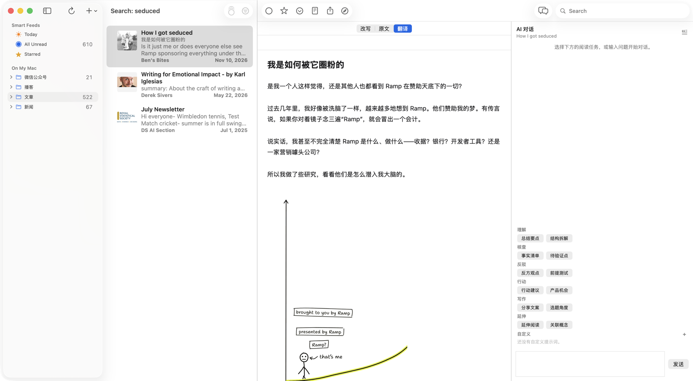
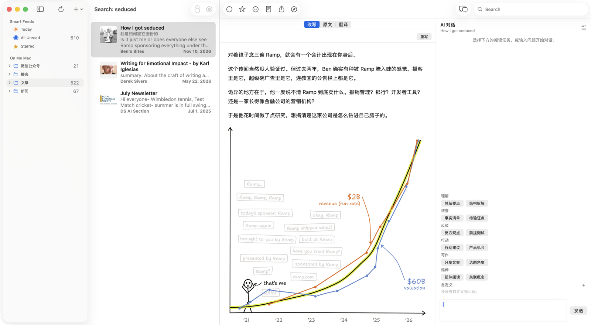
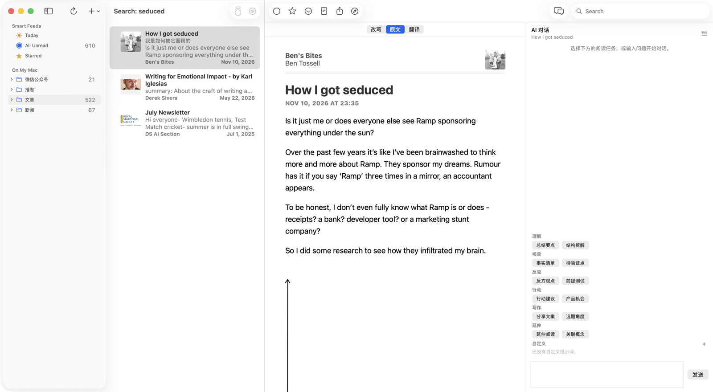
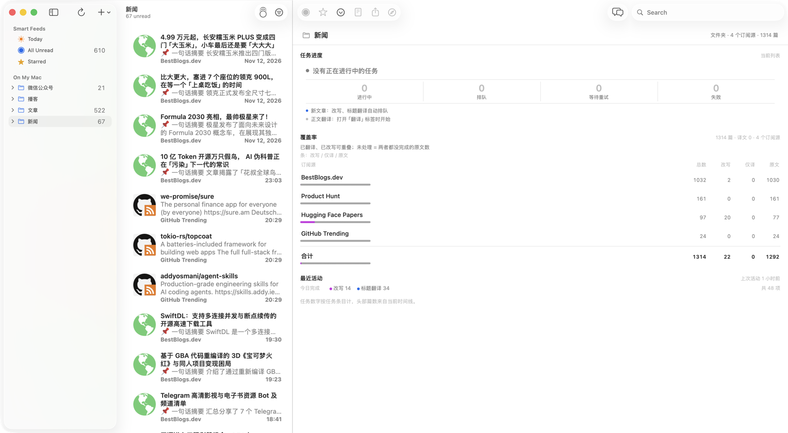

English | [简体中文](README.zh-CN.md)

# NetNewsWire

This is a personal fork of NetNewsWire. Upstream is a native RSS reader for macOS and iOS; this fork adds AI processing, a task dashboard, and feed enhancements on the macOS side. The upstream project is at [https://github.com/Ranchero-Software/NetNewsWire](https://github.com/Ranchero-Software/NetNewsWire), and the website is [https://netnewswire.com/](https://netnewswire.com/).

The AI features require the magpie gateway to be running on the local machine. The iOS side keeps upstream behavior and does not include these AI features.

## Added features

### AI processing

**Chinese titles**

Once the gateway is configured, new non-Chinese articles automatically get a Chinese translated headline, shown below the original title in the timeline. Backlogged titles are sent to the model in batches rather than one request per title.

**Article translation**

Translation is generated only when you open the "Translation" tab in the reading pane; there is no background pre-translation. The whole article is sent to the model first; if it cannot be translated in one pass, the body is split into chunks and retried after a failure. When a chunk fails, already finished chunks are kept, and the next attempt continues from the breakpoint. The translation is displayed as a plain Chinese-only layout.

**Rewrite**

Regular articles, papers, and Product Hunt use different rewrite prompts; Product Hunt appends product rewrite requirements to the regular article prompt. For regular articles, if the feed only provides a summary, the original page is fetched first to extract the body; if the page cannot be fetched, or a longer body cannot be extracted, it falls back to the body supplied by the feed. Papers and Product Hunt skip this step and use the feed content directly. Very short regular articles, or ones with no body, are skipped. The regular article prompt requires keeping the original's key data and core conclusions, omitting nothing and exaggerating nothing, without changing the meaning; the paper prompt additionally requires staying grounded only in the given material and not fabricating experiments or conclusions; the Product Hunt prompt additionally requires not fabricating prices, teams, funding, user numbers, or other information absent from the material. Rewrite results go through quality checks first; results with too little Chinese, too few paragraphs, or a model refusal are not stored.

Automatic rewrites are on by default, covering unread non-Chinese articles from the last 2 days with a body of 200 characters or more; a manually opened rewrite is not limited by this range.

**AI reading companion**

The AI chat on the right saves the full history per article. Each request includes the whole article body and the earlier conversation for that article. It ships with 12 reading tasks, grouped into comprehension, verification, rebuttal, action, writing, and extension; one click sends a task. Custom prompts are capped at 24 and stored locally. After selecting text on the original page you can quote it, bringing it into the input box as a quote block.

**Cache and retries**

Titles and rewrites are cached by content hash and regenerated when the content changes; translations are kept once generated and are not rerun automatically. Failed tasks back off at 10 minutes, 30 minutes, and 2 hours, with at most 4 attempts; tasks in a final failed state can be retried manually from the task dashboard.

### Task dashboard and logs

When no article is selected in the reading pane, the task dashboard is shown, and its scope follows the current list: feed, folder, Today, all unread, or starred. The top row has four counters: in progress, queued, waiting to retry, and failed; below that is per-feed coverage, with columns for rewrite, translation only, and original; failed tasks are grouped by reason, and expanding a group shows which feeds are involved, with a one-click "retry all". If the gateway is not configured, the dashboard says so directly.

Final states of translation, Chinese titles, and rewrite are written to `Application Support/NetNewsWire/AI/logs/ai-tasks-YYYY-MM-DD.jsonl`, that is, `~/Library/Application Support/NetNewsWire/AI/logs/`, one file per day. Logs older than 30 days are cleaned up on write.

### Reading and interface

The main window has four columns: sidebar, list, reading pane, and AI chat pane; the AI pane can be collapsed at any time. The top of the reading pane has up to three tabs: "Rewrite / Original / Translation"; each feed can individually turn off rewrite or translation, and when an article does not support AI, only the original is left.

Immersive reading hides the sidebar and list so the article fills the remaining space; the AI pane keeps its current display state. Press `I` to enter or exit, and `Esc` also exits. `J` / `K` go to the next / previous article, and `A` shows or hides the AI pane. Pressing `Esc` repeatedly closes the AI pane, exits immersive reading, and clears the list selection, in that order.

### Feeds

- RSSHub feeds are tried in instance order, and on a refresh failure the next instance is used automatically.
- Product Hunt is a built-in feed; rewrites use the Product Hunt prompt.
- Hugging Face daily papers are subscribed to through RSSHub, and paper links use the paper rewrite prompt.
- The File menu can import a WeChat public account directory; WeChat article images are loaded and cached through an in-app proxy to avoid hotlink blocking.
- YouTube links in the body are replaced with a `youtube-nocookie.com` embedded player, on the original, rewrite, and translation pages alike.
- X News, Product Hunt, and Hugging Face daily papers are automatically subscribed to the local account on first run.

### Model access

Only the local magpie gateway is supported, at the default address `http://127.0.0.1:3425/v1`. Enter the gateway address and API key in Settings → AI, click "Get model list", then pick a model from the dropdown. The API key is stored in the keychain; the address and model are stored in preferences.

There is no multi-provider support and no OAuth; all AI uses share one model.

## Differences from upstream / not supported

- This is a personal fork, not an official release from Ranchero Software. Upstream does not accept AI features for now, so these changes will not be merged back upstream.
- AI features are available only on macOS and depend on the local magpie gateway; if the gateway is not running or no API key is configured, the AI features are unavailable.
- Article translation provides only a Chinese view; there is no toggle between the original and the translation.
- Product Hunt page-body extraction and the Hugging Face paper structured card currently have only an implementation and tests; they are not wired into the reading and rewrite flows yet.
- No multi-user accounts, self-hosting, community, public archiving, web clipping, HN combined stream, time shuffling, same-source consecutive limits, podcast transcripts, or YouTube subtitle notes, and no per-purpose model configuration.

## Upstream and license

This project is based on [https://github.com/Ranchero-Software/NetNewsWire](https://github.com/Ranchero-Software/NetNewsWire) and keeps the upstream MIT license, see [LICENSE](LICENSE).

- Website: [https://netnewswire.com/](https://netnewswire.com/)
- Upstream issues and feature requests: [https://github.com/Ranchero-Software/NetNewsWire/issues](https://github.com/Ranchero-Software/NetNewsWire/issues)
- Upstream release notes: [https://github.com/Ranchero-Software/NetNewsWire/releases/](https://github.com/Ranchero-Software/NetNewsWire/releases/)
- Community forum: [https://discourse.netnewswire.com/](https://discourse.netnewswire.com/)

Do not report issues with this fork's AI features upstream; please file them in this repository.
